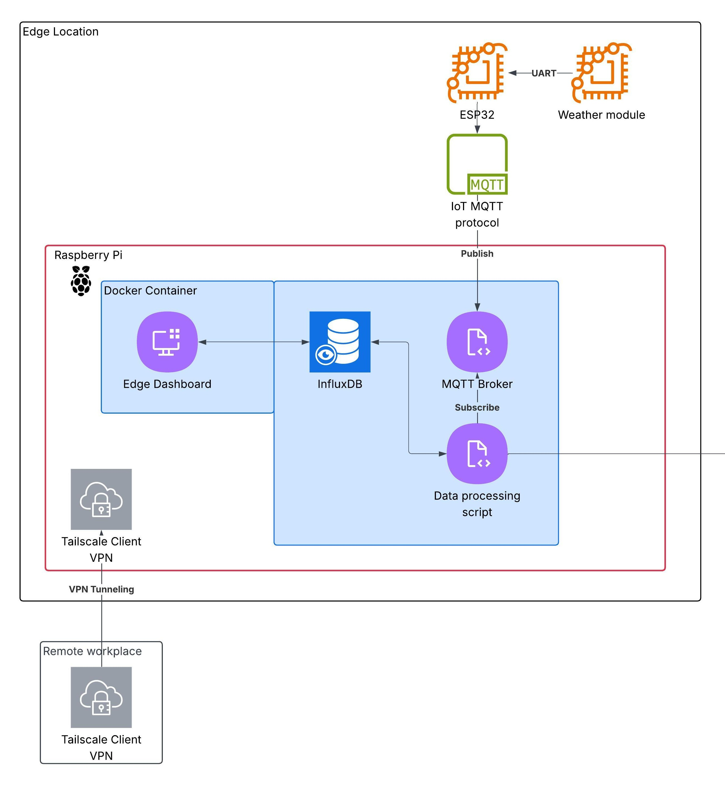
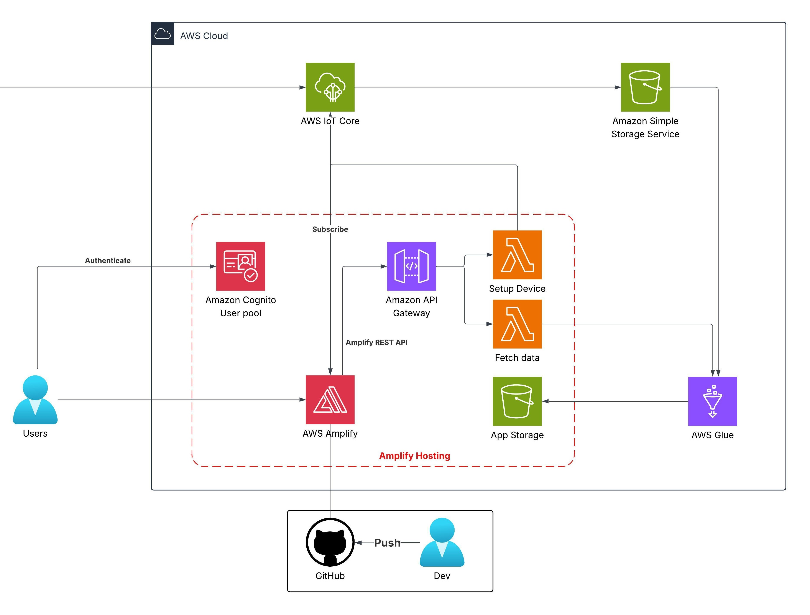

# IoT Weather Platform for Lab Research
## A Unified AWS Serverless Solution for Real-Time Weather Monitoring

### 1. Executive Summary
The IoT Weather Platform is designed for the *ITea Lab* research team in Ho Chi Minh City to modernize weather data collection, security, and analysis. It supports up to 5 weather stations, scalable to 10–15 stations, utilizing Raspberry Pi edge devices with ESP32 sensors transmitting telemetry over TLS-encrypted MQTT. The platform leverages AWS Serverless services to deliver real-time monitoring, predictive analytics, and high cost efficiency, with access strictly authenticated for lab members via Amazon Cognito.

### 2. Problem Statement
*Current Challenges*
Existing weather stations rely on manual data collection, which becomes error-prone and unmanageable across multiple units. There is no centralized repository for real-time telemetry or analytics, while commercial third-party IoT platforms are costly and overly complex for internal lab operations.

*The Solution*
The platform uses AWS IoT Core to ingest MQTT telemetry securely, AWS Lambda and Amazon API Gateway for event-driven processing, Amazon S3 for durable storage (including a raw Data Lake and processed analytics bucket), and AWS Glue Crawlers and ETL jobs for data cataloging and transformation. AWS Amplify hosts the Next.js web dashboard, while Amazon Cognito enforces user authentication. Key benefits include real-time dashboards, trend analytics, end-to-end security, and minimal operational overhead.

*Benefits and Return on Investment (ROI)*
The solution establishes a scalable cloud foundation for IoT and AI research while eliminating manual data aggregation. Monthly AWS operating costs are estimated at **$0.70 USD** via the AWS Pricing Calculator (**$8.40 USD/year**). All edge hardware is already provisioned, resulting in a 6–12 month break-even period through significant operational time savings.

### 3. Solution Architecture
The platform employs an event-driven AWS Serverless architecture managing telemetry from 5 Raspberry Pi stations (scalable to 15). Data is ingested via AWS IoT Core, persisted in an Amazon S3 Data Lake, and cataloged/transformed by AWS Glue Crawlers and ETL jobs into an analytics S3 Bucket. AWS Lambda and Amazon API Gateway power backend APIs, while AWS Amplify hosts the Next.js dashboard protected by Amazon Cognito.

*AWS Services Used*
- **AWS IoT Core**: Ingests TLS-encrypted MQTT data from 5 edge stations, scalable to 15.
- **AWS Lambda**: Processes telemetry events and orchestrates Glue ETL triggers.
- **Amazon API Gateway**: Exposes secure REST/HTTP endpoints for the web dashboard.
- **Amazon S3**: Stores raw telemetry (Data Lake) and transformed datasets across two private, encrypted buckets.
- **AWS Glue**: Crawlers maintain the Data Catalog and ETL jobs transform raw records for analysis.
- **AWS Amplify**: Provides CI/CD build and hosting for the Next.js web application.
- **Amazon Cognito**: Manages user authentication and JWT authorization for lab members.

*Component Design*
- **Edge Devices**: Raspberry Pi aggregates and filters ESP32 sensor readings before publishing to AWS IoT Core.
- **Data Ingestion**: AWS IoT Core authenticates X.509 device certificates and routes MQTT payloads.
- **Data Storage**: Raw telemetry lands in the S3 Data Lake bucket; curated data is stored in the S3 Analytics bucket.
- **Data Processing**: AWS Glue Crawlers index schema changes and ETL jobs normalize records.
- **Web Interface**: AWS Amplify hosts the Next.js dashboard for real-time visualization.
- **User Management**: Amazon Cognito User Pool restricts access to authorized lab researchers.

### 4. Technical Implementation
*Implementation Phases*
1. **Architecture Design & Research**: Validate Raspberry Pi + ESP32 sensor integration and design the AWS Serverless architecture aligned with the AWS Well-Architected Framework.
2. **Cost Estimation & Feasibility**: Model expected workloads using the AWS Pricing Calculator (Month 1).
3. **Architecture Refinement & Security Hardening**: Enforce Least-Privilege IAM Roles, S3 bucket encryption/policies, and Cognito JWT verification (Month 2).
4. **Development, Testing & Deployment**: Configure AWS resources via SDK/CloudFormation, deploy the Next.js frontend on Amplify, and conduct End-to-End testing (Months 2–3).

*Technical Requirements*
- **Weather Edge Station**: Temperature, humidity, rainfall, and wind sensors connected to an ESP32 and Raspberry Pi running Docker to filter noise and transmit ~1 MB/day/station via MQTT over Wi-Fi.
- **Cloud Platform**: AWS Amplify (Next.js), AWS Lambda, AWS Glue (ETL), Amazon S3 (2 private buckets), AWS IoT Core (Rules & Policies), and Amazon Cognito.

### 5. Timeline & Milestones
- **Preparation Phase**: Review existing station hardware and finalize system requirements.
- **Internship Execution (3 Months / 12 Weeks)**:
  - *Month 1 (Weeks 1–4)*: Master AWS fundamentals (IAM, VPC, EC2, S3, RDS) and prepare edge hardware.
  - *Month 2 (Weeks 5–8)*: Finalize architecture, implement private VPC Endpoint connectivity, build Serverless APIs, Cognito authentication, and KMS/Secrets protection.
  - *Month 3 (Weeks 9–12)*: Harden application delivery (CloudFront, WAF), configure observability (CloudWatch, CloudTrail), run E2E tests, and complete final delivery.

### 6. Budget Estimation
Detailed cost modeling is available on the [AWS Pricing Calculator](https://calculator.aws/#/estimate?id=621f38b12a1ef026842ba2ddfe46ff936ed4ab01).

*Monthly Infrastructure Cost Breakdown:*
- **AWS Lambda**: $0.00/month (1,000 requests, 512 MB memory — within Free Tier).
- **Amazon S3 Standard**: $0.15/month (6 GB storage, 2,100 requests).
- **Data Transfer**: $0.02/month (1 GB inbound, 1 GB outbound).
- **AWS Amplify**: $0.35/month (256 MB, 500 ms requests).
- **Amazon API Gateway**: $0.01/month (2,000 requests).
- **AWS Glue ETL Jobs**: $0.02/month (2 DPUs).
- **AWS Glue Crawlers**: $0.07/month (1 crawler).
- **AWS IoT Core (MQTT)**: $0.08/month (5 devices, 45,000 messages).

**Total AWS Cost**: **~$0.70/month** ($8.40/12 months).
- **Hardware**: $265 one-time initial investment (Raspberry Pi 5 and environmental sensors).

### 7. Risk Assessment
*Risk Matrix*
- **Network Outages**: Medium impact, medium probability.
- **Sensor Hardware Failures**: High impact, low probability.
- **Cost Overruns**: Medium impact, low probability.

*Mitigation Strategies*
- **Network**: Local containerized buffering on Raspberry Pi with automatic retry upon reconnection.
- **Sensors**: Routine calibration checks and spare sensor modules.
- **Cost & Security**: AWS Budgets threshold alerts, API Gateway throttling, and Least-Privilege IAM policies.

*Contingency Plans*
- Export local buffered data from Raspberry Pi storage during prolonged connectivity outages.
- Use AWS CloudFormation templates for rapid stack rollback or redeployment.

### 8. Expected Outcomes
- **Technical Improvements**: Automated, real-time telemetry ingestion and analytics replacing manual workflows, scalable to 10–15 stations.
- **Long-Term Value**: A clean, well-governed dataset supporting future AI/ML forecasting models and a reusable AWS Serverless reference architecture.
