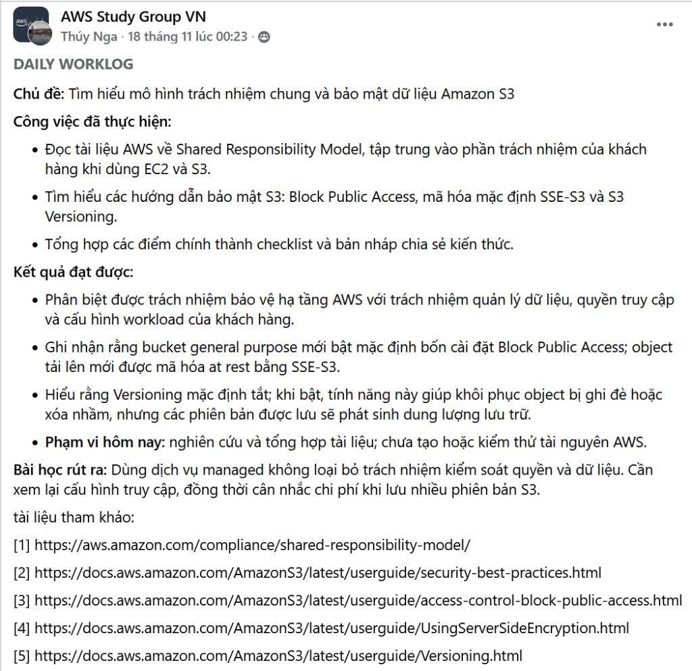

# Exploring the Shared Responsibility Model and Amazon S3 Data Security

* **Published on:** [AWS Study Group VN Facebook Group](https://www.facebook.com/groups/660548818043427/user/100016726392723)
* **Author:** Thuy Nga

---

### Tasks Completed

* Studied official AWS documentation on the **Shared Responsibility Model**, focusing on customer security responsibilities when using **Amazon EC2** and **Amazon S3**.
* Reviewed Amazon S3 security guidelines: **Block Public Access**, default **SSE-S3** encryption, and **S3 Versioning**.
* Synthesized key takeaways into a practical security checklist and knowledge-sharing post.

### Key Findings & Outcomes

* Clearly distinguished AWS's responsibility for protecting the underlying cloud infrastructure from the customer's responsibility for governing data, access permissions, and workload configurations.
* Noted that new general-purpose S3 buckets enable all four **Block Public Access** settings by default, and newly uploaded objects are automatically encrypted at rest using **SSE-S3**.
* Understood that **S3 Versioning** is disabled by default; when enabled, it protects against accidental overwrites and deletions by preserving multiple object versions, though retained versions consume additional storage capacity.

### Lesson Learned

Adopting a managed cloud service does not eliminate the customer's responsibility to govern access permissions and protect data. Engineers must regularly audit access configurations and balance data recovery requirements against storage costs when enabling S3 Versioning.

### References

1. [AWS Shared Responsibility Model](https://aws.amazon.com/compliance/shared-responsibility-model/)
2. [Amazon S3 Security Best Practices](https://docs.aws.amazon.com/AmazonS3/latest/userguide/security-best-practices.html)
3. [Blocking public access to your Amazon S3 storage](https://docs.aws.amazon.com/AmazonS3/latest/userguide/access-control-block-public-access.html)
4. [Using server-side encryption with Amazon S3](https://docs.aws.amazon.com/AmazonS3/latest/userguide/UsingServerSideEncryption.html)
5. [Retaining multiple versions of objects with S3 Versioning](https://docs.aws.amazon.com/AmazonS3/latest/userguide/Versioning.html)

---

### Original Post on AWS Study Group VN

