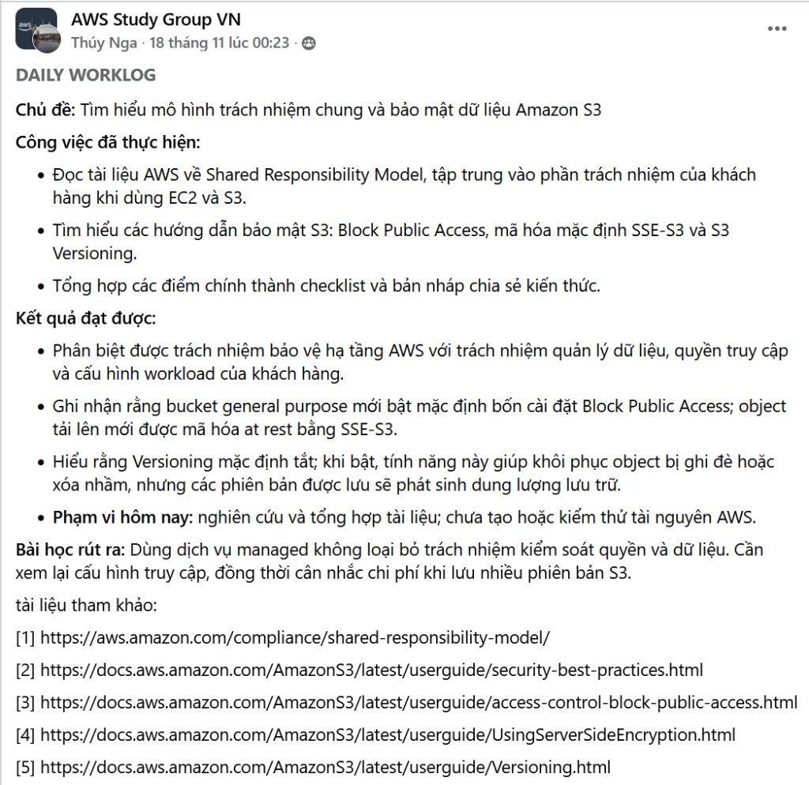

# Tìm hiểu mô hình trách nhiệm chung và bảo mật dữ liệu Amazon S3

* **Nơi đăng:** [Nhóm Facebook AWS Study Group VN](https://www.facebook.com/groups/660548818043427/user/100016726392723)
* **Tác giả:** Thúy Nga

---

### Công việc đã thực hiện

* Đọc tài liệu AWS về **Shared Responsibility Model**, tập trung vào phần trách nhiệm của khách hàng khi dùng **Amazon EC2** và **Amazon S3**.
* Tìm hiểu các hướng dẫn bảo mật S3: **Block Public Access**, mã hóa mặc định **SSE-S3** và **S3 Versioning**.
* Tổng hợp các điểm chính thành checklist và bản nháp chia sẻ kiến thức.

### Kết quả đạt được

* Phân biệt được trách nhiệm bảo vệ hạ tầng AWS với trách nhiệm quản lý dữ liệu, quyền truy cập và cấu hình workload của khách hàng.
* Ghi nhận rằng bucket general purpose mới bật mặc định bốn cài đặt **Block Public Access**; object tải lên mới được mã hóa at rest bằng **SSE-S3**.
* Hiểu rằng **Versioning** mặc định tắt; khi bật, tính năng này giúp khôi phục object bị ghi đè hoặc xóa nhầm, nhưng các phiên bản được lưu sẽ phát sinh dung lượng lưu trữ.
* Phạm vi nghiên cứu: nghiên cứu và tổng hợp tài liệu chính thống từ AWS Documentation để chuẩn bị nền tảng vững chắc trước khi triển khai và kiểm thử tài nguyên.

### Bài học rút ra

Dùng dịch vụ managed không loại bỏ trách nhiệm kiểm soát quyền và dữ liệu. Cần xem lại cấu hình truy cập, đồng thời cân nhắc chi phí khi lưu nhiều phiên bản S3.

### Tài liệu tham khảo

1. [AWS Shared Responsibility Model](https://aws.amazon.com/compliance/shared-responsibility-model/)
2. [Amazon S3 Security Best Practices](https://docs.aws.amazon.com/AmazonS3/latest/userguide/security-best-practices.html)
3. [Blocking public access to your Amazon S3 storage](https://docs.aws.amazon.com/AmazonS3/latest/userguide/access-control-block-public-access.html)
4. [Using server-side encryption with Amazon S3](https://docs.aws.amazon.com/AmazonS3/latest/userguide/UsingServerSideEncryption.html)
5. [Retaining multiple versions of objects with S3 Versioning](https://docs.aws.amazon.com/AmazonS3/latest/userguide/Versioning.html)

---

### Hình ảnh bài đăng trên AWS Study Group VN

