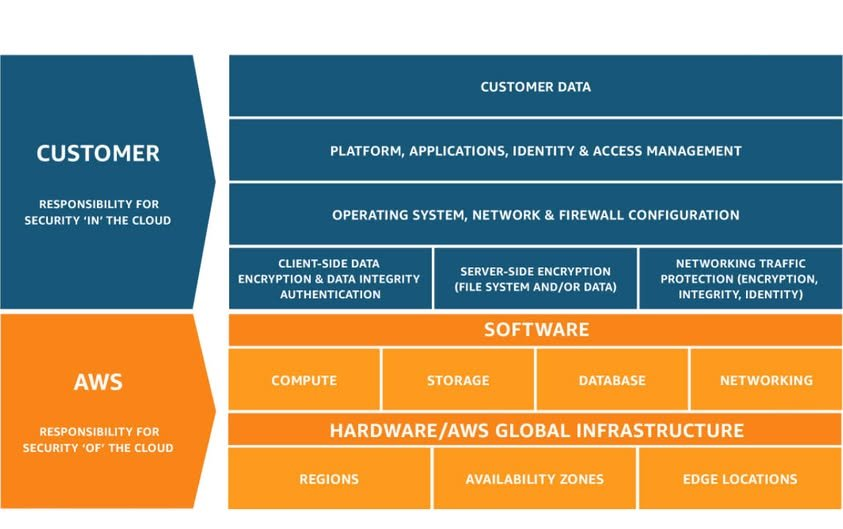
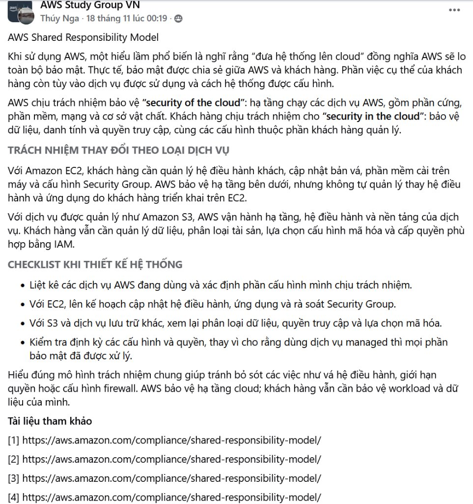

# AWS Shared Responsibility Model

* **Published on:** [AWS Study Group VN Facebook Group](https://www.facebook.com/groups/660548818043427/user/100016726392723)
* **Author:** Thuy Nga

---

When adopting AWS, a common misconception is assuming that *"moving to the cloud"* means AWS handles 100% of security. In reality, security is a shared responsibility between AWS and the customer. The exact scope of customer responsibility depends on the specific AWS services selected and how workloads are configured.

AWS is responsible for **“Security of the Cloud”**: protecting the global infrastructure that runs all AWS services, including hardware, software, networking, and physical facilities. Customers are responsible for **“Security in the Cloud”**: protecting customer data, identities, access permissions, and service configurations under customer control.

### Responsibilities Shift by Service Model

* **With Amazon EC2 (IaaS):** Customers must manage the guest operating system, security patches, installed application software, and Security Group firewall rules. AWS secures the underlying physical hosts and hypervisor, but does not patch or manage guest OS instances on the customer's behalf.
* **With Managed Services like Amazon S3:** AWS operates the infrastructure layer, storage operating system, and service platform. Customers remain responsible for data classification, encryption configuration choices, bucket policies, and IAM access permissions.

### System Design Security Checklist

* Inventory all AWS services used in your architecture and explicitly document which configuration layers belong to your team.
* For EC2 workloads, establish a schedule for OS patching, application updates, and Security Group audits.
* For Amazon S3 and storage services, review data classification, public access controls, and encryption settings.
* Conduct periodic configuration and permission reviews rather than assuming a managed service automatically handles your data security posture.

Understanding the Shared Responsibility Model prevents critical security gaps such as unpatched guest operating systems, overly broad IAM permissions, or misconfigured firewall rules. AWS secures the cloud infrastructure; customers must actively secure their workloads and data.

### References

1. [AWS Shared Responsibility Model](https://aws.amazon.com/compliance/shared-responsibility-model/)

`#AWS` `#CloudSecurity` `#SharedResponsibility`

---

### Original Post on AWS Study Group VN

