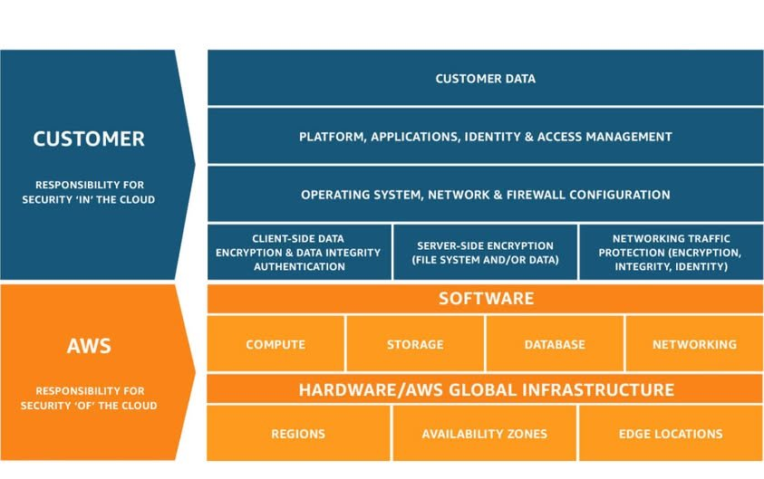
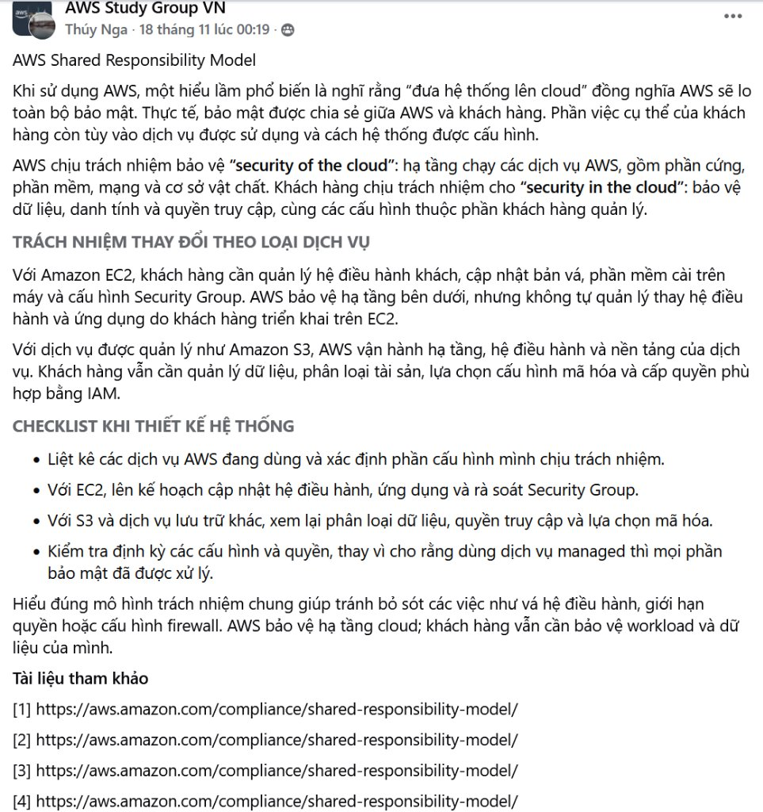

# AWS Shared Responsibility Model

* **Nơi đăng:** [Nhóm Facebook AWS Study Group VN](https://www.facebook.com/groups/660548818043427/user/100016726392723)
* **Tác giả:** Thúy Nga

---

Khi sử dụng AWS, một hiểu lầm phổ biến là nghĩ rằng *“đưa hệ thống lên cloud”* đồng nghĩa AWS sẽ lo toàn bộ bảo mật. Thực tế, bảo mật được chia sẻ giữa AWS và khách hàng. Phần việc cụ thể của khách hàng còn tùy vào dịch vụ được sử dụng và cách hệ thống được cấu hình.

AWS chịu trách nhiệm bảo vệ **“security of the cloud”**: hạ tầng chạy các dịch vụ AWS, gồm phần cứng, phần mềm, mạng và cơ sở vật chất. Khách hàng chịu trách nhiệm cho **“security in the cloud”**: bảo vệ dữ liệu, danh tính và quyền truy cập, cùng các cấu hình thuộc phần khách hàng quản lý.

### Trách nhiệm thay đổi theo loại dịch vụ

* **Với Amazon EC2:** Khách hàng cần quản lý hệ điều hành khách (Guest OS), cập nhật bản vá, phần mềm cài trên máy và cấu hình Security Group. AWS bảo vệ hạ tầng bên dưới, nhưng không tự quản lý thay hệ điều hành và ứng dụng do khách hàng triển khai trên EC2.
* **Với dịch vụ được quản lý như Amazon S3:** AWS vận hành hạ tầng, hệ điều hành và nền tảng của dịch vụ. Khách hàng vẫn cần quản lý dữ liệu, phân loại tài sản, lựa chọn cấu hình mã hóa và cấp quyền phù hợp bằng IAM.

### Checklist khi thiết kế hệ thống

* Liệt kê các dịch vụ AWS đang dùng và xác định phần cấu hình mình chịu trách nhiệm.
* Với EC2, lên kế hoạch cập nhật hệ điều hành, ứng dụng và rà soát Security Group.
* Với S3 và dịch vụ lưu trữ khác, xem lại phân loại dữ liệu, quyền truy cập và lựa chọn mã hóa.
* Kiểm tra định kỳ các cấu hình và quyền, thay vì cho rằng dùng dịch vụ managed thì mọi phần bảo mật đã được xử lý.

Hiểu đúng mô hình trách nhiệm chung giúp tránh bỏ sót các việc như vá hệ điều hành, giới hạn quyền hoặc cấu hình firewall. AWS bảo vệ hạ tầng cloud; khách hàng vẫn cần bảo vệ workload và dữ liệu của mình.

### Tài liệu tham khảo

1. [AWS Shared Responsibility Model](https://aws.amazon.com/compliance/shared-responsibility-model/)

`#AWS` `#CloudSecurity` `#SharedResponsibility`

---

### Hình ảnh bài đăng trên AWS Study Group VN

