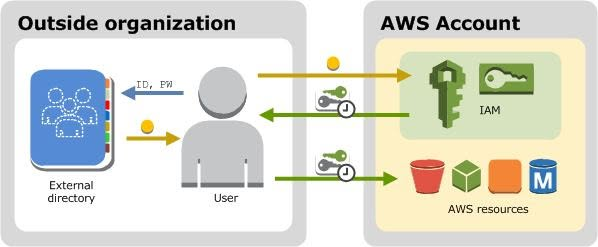
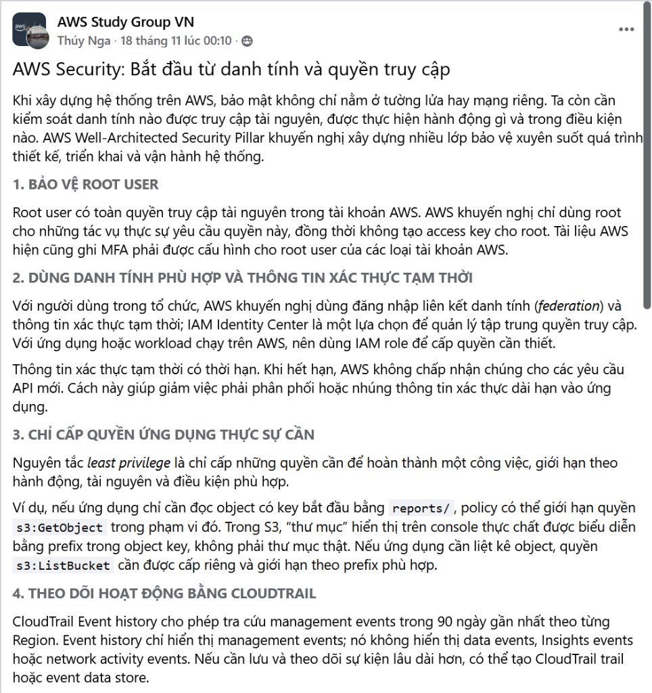
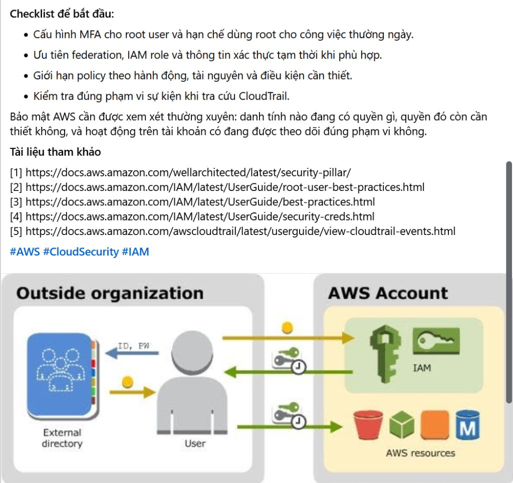

# AWS Security: Starting with Identity and Access Control

* **Published on:** [AWS Study Group VN Facebook Group](https://www.facebook.com/groups/660548818043427/user/100016726392723)
* **Author:** Thuy Nga

---

When building systems on AWS, security goes beyond firewalls and private networks. You must strictly govern which identities can access resources, what actions they are permitted to perform, and under which conditions. The **AWS Well-Architected Security Pillar** recommends establishing layered identity controls across design, deployment, and operations.

### 1. Protect the Root User

The AWS account Root user holds unrestricted access to all resources in the account. AWS strongly recommends using the Root user only for tasks that explicitly require root privileges, and never creating programmatic access keys for the Root user. Multi-Factor Authentication (**MFA**) must be enforced on the Root user across all AWS account types.

### 2. Use Appropriate Identities and Temporary Credentials

For human users within an organization, AWS recommends identity **federation** with short-lived credentials; **AWS IAM Identity Center** provides centralized multi-account access management. For applications and compute workloads running on AWS, always use **IAM Roles** to provide temporary credentials.

Temporary credentials automatically expire after a defined lifetime, after which AWS rejects them for new API requests. This eliminates the risk of distributing or embedding long-term static credentials in application code.

### 3. Grant Only the Permissions Workloads Actually Need (Least Privilege)

The **Principle of Least Privilege** means granting only the minimum permissions required to complete a specific task, scoped by actions, resources, and conditions.

For example, if an application only needs to read objects whose keys start with `reports/`, the IAM policy should scope `s3:GetObject` strictly to that prefix (`arn:aws:s3:::example-bucket/reports/*`). In Amazon S3, "folders" shown in the console are actually object key prefixes rather than physical directories. If the workload also needs to list objects under that prefix, `s3:ListBucket` must be granted separately on the bucket ARN with a `s3:prefix` condition.

### 4. Audit Account Activity with AWS CloudTrail

**CloudTrail Event History** provides a 90-day searchable record of management events per AWS Region. By default, Event History displays only management events-it does not include data events, CloudTrail Insights events, or network activity events. For long-term retention, multi-region auditing, and data event visibility, configure a dedicated **CloudTrail Trail** or **CloudTrail Lake Event Data Store**.

### Getting Started Checklist

* Enable MFA for the Root user and stop using Root for everyday administrative tasks.
* Prefer identity federation, IAM Roles, and temporary credentials over static IAM access keys.
* Scope IAM policies tightly by specific actions, resource ARNs, and conditions.
* Verify event scope coverage when investigating activity in AWS CloudTrail.

Cloud security requires continuous review: regularly verify which identities hold permissions, whether those permissions remain necessary, and whether account activity is being logged at the required depth.

### References

1. [AWS Well-Architected Framework – Security Pillar](https://docs.aws.amazon.com/wellarchitected/latest/security-pillar/)
2. [Best practices to protect your AWS account root user](https://docs.aws.amazon.com/IAM/latest/UserGuide/root-user-best-practices.html)
3. [Security best practices in IAM](https://docs.aws.amazon.com/IAM/latest/UserGuide/best-practices.html)
4. [AWS security credentials](https://docs.aws.amazon.com/IAM/latest/UserGuide/security-creds.html)
5. [Viewing recent management events with the CloudTrail console](https://docs.aws.amazon.com/awscloudtrail/latest/userguide/view-cloudtrail-events.html)

`#AWS` `#CloudSecurity` `#IAM`

---

### Original Post on AWS Study Group VN

