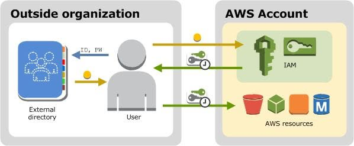
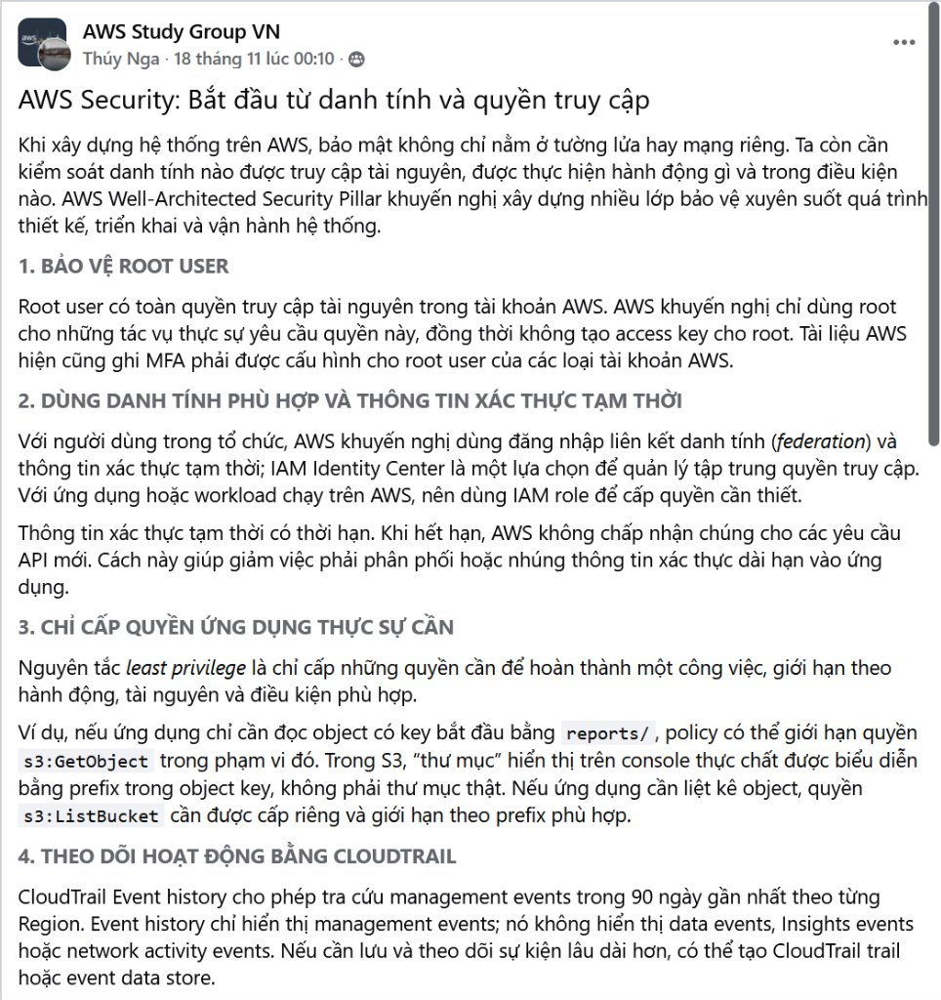
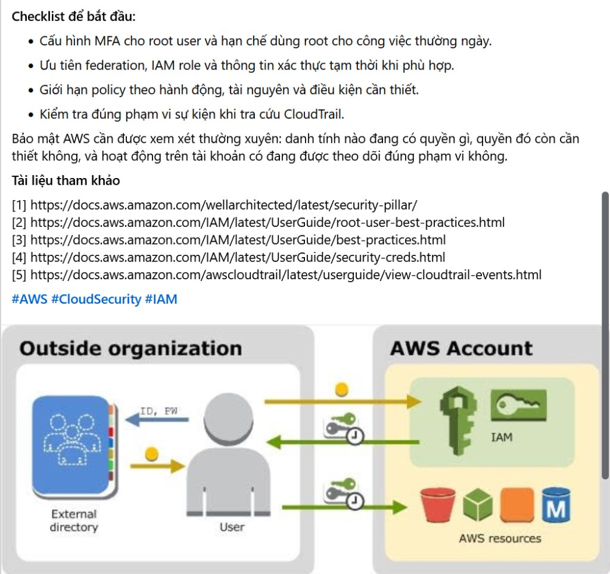

# AWS Security: Bắt đầu từ danh tính và quyền truy cập

* **Nơi đăng:** [Nhóm Facebook AWS Study Group VN](https://www.facebook.com/groups/660548818043427/user/100016726392723)
* **Tác giả:** Thúy Nga

---

Khi xây dựng hệ thống trên AWS, bảo mật không chỉ nằm ở tường lửa hay mạng riêng. Ta còn cần kiểm soát danh tính nào được truy cập tài nguyên, được thực hiện hành động gì và trong điều kiện nào. **AWS Well-Architected Security Pillar** khuyến nghị xây dựng nhiều lớp bảo vệ xuyên suốt quá trình thiết kế, triển khai và vận hành hệ thống.

### 1. Bảo vệ Root User

Root user có toàn quyền truy cập tài nguyên trong tài khoản AWS. AWS khuyến nghị chỉ dùng root cho những tác vụ thực sự yêu cầu quyền này, đồng thời không tạo access key cho root. Tài liệu AWS hiện cũng ghi **MFA** phải được cấu hình cho root user của các loại tài khoản AWS.

### 2. Dùng danh tính phù hợp và thông tin xác thực tạm thời

Với người dùng trong tổ chức, AWS khuyến nghị dùng đăng nhập liên kết danh tính (*federation*) và thông tin xác thực tạm thời; **IAM Identity Center** là một lựa chọn để quản lý tập trung quyền truy cập. Với ứng dụng hoặc workload chạy trên AWS, nên dùng **IAM Role** để cấp quyền cần thiết.

Thông tin xác thực tạm thời có thời hạn. Khi hết hạn, AWS không chấp nhận chúng cho các yêu cầu API mới. Cách này giúp giảm việc phải phân phối hoặc nhúng thông tin xác thực dài hạn vào ứng dụng.

### 3. Chỉ cấp quyền ứng dụng thực sự cần (Least Privilege)

Nguyên tắc *least privilege* là chỉ cấp những quyền cần để hoàn thành một công việc, giới hạn theo hành động, tài nguyên và điều kiện phù hợp.

Ví dụ, nếu ứng dụng chỉ cần đọc object có key bắt đầu bằng `reports/`, policy có thể giới hạn quyền `s3:GetObject` trong phạm vi đó. Trong S3, “thư mục” hiển thị trên console thực chất được biểu diễn bằng prefix trong object key, không phải thư mục thật. Nếu ứng dụng cần liệt kê object, quyền `s3:ListBucket` cần được cấp riêng và giới hạn theo prefix phù hợp.

### 4. Theo dõi hoạt động bằng CloudTrail

**CloudTrail Event history** cho phép tra cứu management events trong 90 ngày gần nhất theo từng Region. Event history chỉ hiển thị management events; nó không hiển thị data events, Insights events hoặc network activity events. Nếu cần lưu và theo dõi sự kiện lâu dài hơn, có thể tạo **CloudTrail trail** hoặc **event data store**.

### Checklist để bắt đầu

* Cấu hình MFA cho root user và hạn chế dùng root cho công việc thường ngày.
* Ưu tiên federation, IAM role và thông tin xác thực tạm thời khi phù hợp.
* Giới hạn policy theo hành động, tài nguyên và điều kiện cần thiết.
* Kiểm tra đúng phạm vi sự kiện khi tra cứu CloudTrail.

Bảo mật AWS cần được xem xét thường xuyên: danh tính nào đang có quyền gì, quyền đó còn cần thiết không, và hoạt động trên tài khoản có đang được theo dõi đúng phạm vi không.

### Tài liệu tham khảo

1. [AWS Well-Architected Framework – Security Pillar](https://docs.aws.amazon.com/wellarchitected/latest/security-pillar/)
2. [Best practices for protect your AWS account root user](https://docs.aws.amazon.com/IAM/latest/UserGuide/root-user-best-practices.html)
3. [Security best practices in IAM](https://docs.aws.amazon.com/IAM/latest/UserGuide/best-practices.html)
4. [AWS security credentials](https://docs.aws.amazon.com/IAM/latest/UserGuide/security-creds.html)
5. [Viewing recent management events with the CloudTrail console](https://docs.aws.amazon.com/awscloudtrail/latest/userguide/view-cloudtrail-events.html)

`#AWS` `#CloudSecurity` `#IAM`

---

### Hình ảnh bài đăng trên AWS Study Group VN

