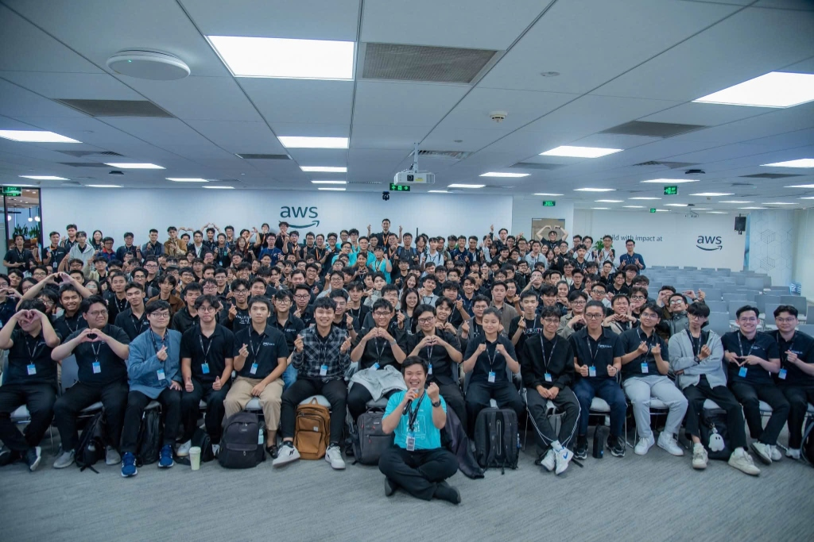
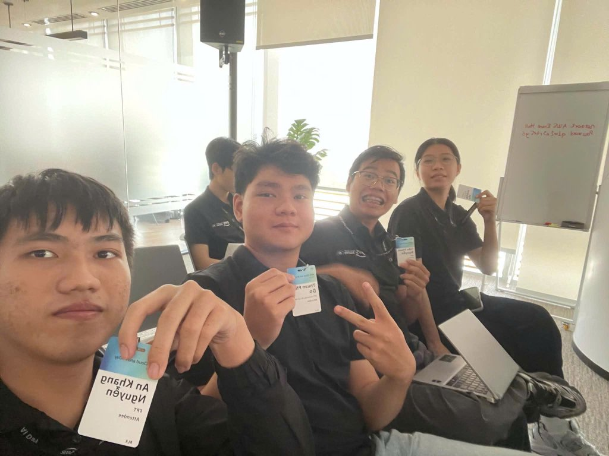

# Event Report: “AWS Cloud & AI Day 2026: HCMC Watch Party”

### 1. Event Information

* **Event Name:** AWS Cloud & AI Day 2026 – HCMC Watch Party
* **Organizer:** AWS Vietnam & AWS Study Group VN Community
* **Date:** 29/09/2026
* **Location:** AWS Vietnam Office – 26th Floor, Bitexco Financial Tower, 02 Hai Trieu Street, District 1, Ho Chi Minh City
* **Role:** Attendee (First Cloud AI Journey Intern)
* **Event Recap Post on AWS Study Group VN:** [View Official Recap Post on Facebook Group](https://www.facebook.com/groups/awsstudygroupfcj/permalink/2292589671505992/)

---

### 2. Event Purpose

* Connect over 300 Cloud & AI Builders in Ho Chi Minh City directly with the flagship **AWS Cloud & AI Day 2026** autumn conference keynote in Hanoi.
* Share strategic updates on **Agentic AI**, building resilient **Data Foundations**, and enterprise cloud modernization strategies on AWS.
* Foster interactive roundtable discussions on-site at the AWS HCMC office among students, developers, and AWS Solutions Architects on transitioning Cloud & AI prototypes into secure, cost-effective production workloads.

---

### 3. Key Highlights & Activities

#### 1. Strategic Insights from the AWS Cloud & AI Day 2026 Keynote
* **The Rise of Agentic AI:** Moving beyond simple Q&A chatbots toward autonomous **AI Agents** capable of multi-step reasoning, tool invocation, and workflow execution on AWS (Amazon Bedrock).
* **Building a Strong Data Foundation:** Reliable AI and analytics depend on clean, well-governed data architectures powered by services such as Amazon S3, Amazon DynamoDB, and modern serverless data pipelines.
* **Cloud Modernization & Built-In Security:** Adopting Serverless and Event-Driven architectures to accelerate delivery while maintaining strict identity governance (IAM, Guardrails) and high availability.

#### 2. Hands-On Roundtable Discussions at the HCMC Venue
* Beyond watching the keynote stream, AWS Solutions Architects, developers, and FCAJ interns engaged in lively breakout discussions tackling practical engineering questions:
  - How to bridge the gap from experimental PoC prototypes to reliable, secure production operations on AWS.
  - Practical strategies to control and optimize cloud infrastructure costs from Day 1 for student and startup-scale workloads.

#### 3. Community Networking at the AWS Vietnam Office
* Brought together more than 300 builders and university students across Ho Chi Minh City at Level 26 Bitexco, embodying the collaborative *"Learn and Share"* spirit of **AWS Study Group VN**.

---

### 4. Key Takeaways & Application to My Internship

* **Shaping Our SecureTable Project Architecture:** Insights on Serverless modernization, structured data foundations, and early cost awareness from the `29/09/2026` event directly informed our team's design of **SecureTable** (combining S3, CloudFront, API Gateway, Lambda, DynamoDB, and EventBridge Scheduler).
* **Data Governance & Security Mindset:** As an **Information Assurance** student, the discussions reinforced why strict data access boundaries (Least-Privilege IAM) and security guardrails must precede automation or AI adoption.
* **Early Cohort Connection:** Provided an energizing opportunity to connect in person with mentors and fellow `FCAJ-FALL26` teammates during the first month of the internship.

---

### 5. Event Check-in Photo at the AWS Vietnam Office

