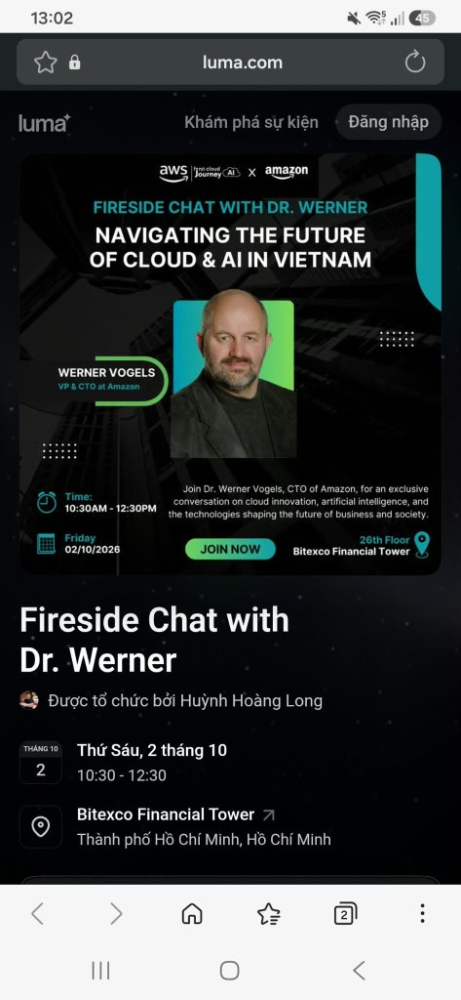

# Event Report: “Fireside Chat with Dr. Werner: Navigating the Future of Cloud & AI in Vietnam”

### 1. Event Information

* **Event Name:** Fireside Chat with Dr. Werner: Navigating the Future of Cloud & AI in Vietnam
* **Keynote Speaker:** **Dr. Werner Vogels** — Vice President & Chief Technology Officer (VP & CTO) at Amazon
* **Organizer:** AWS First Cloud AI Journey x Amazon (Hosted by **Huynh Hoang Long**)
* **Date & Time:** 10:30 – 12:30, Friday, 02/10/2026
* **Location:** 26th Floor, Bitexco Financial Tower, 02 Hai Trieu Street, District 1, Ho Chi Minh City
* **Role:** Attendee (First Cloud AI Journey Intern)

---

### 2. Event Purpose

* Provide an exclusive, in-person fireside conversation between **Dr. Werner Vogels (CTO of Amazon)** and young cloud engineers and **First Cloud AI Journey** interns in Vietnam.
* Share strategic insights on cloud innovation, artificial intelligence, and the technologies shaping the future of business and society in Vietnam and Southeast Asia.
* Inspire the next generation of Vietnamese builders with distributed systems engineering principles, Amazon's **"Invent and Simplify"** culture, and career guidance for the Cloud & AI era.

---

### 3. Key Highlights from Dr. Werner Vogels' Session

#### 1. "The Frugal Architect" & Pragmatic System Design
* **Security and Cost as First-Class Non-Functional Requirements:** Building on the cloud is not just about making features work; **Security**, **Resilience**, and **Cost Awareness** must be architected in from Day 1.
* **"Everything fails, all the time":** Distributed systems must be designed assuming components will fail or face threats. Multi-AZ network isolation, automated recovery, and blast-radius reduction are essential for continuous availability.

#### 2. From AI Hype to Solving Real-World Problems in Vietnam
* Generative AI does not replace core software and cloud engineering fundamentals; rather, **well-governed data** and **secure cloud infrastructure** are prerequisites for effective AI adoption.
* Encouraged Vietnamese students and builders to apply Cloud and AI to solve high-impact local problems—such as smart agriculture, environmental and weather monitoring, education, digital finance, and cybersecurity.

#### 3. Security and Responsibility in the Age of AI
* From an Information Security perspective, integrating AI requires strict data access governance (IAM), end-to-end encryption, and safety guardrails to protect customer privacy.
* While AI coding assistants (such as Amazon Q Developer) accelerate development velocity, **the human engineer remains fully accountable** for reviewing every configuration line and IAM policy before production deployment.

#### 4. Advice for Young Engineers and Students in Vietnam
* **Master the Fundamentals:** Deeply understand computer networking (DNS, TCP/IP, routing), operating systems, databases, and identity security—tools evolve rapidly, but distributed systems fundamentals endure.
* **Learn by Building ("Build, Break, and Learn"):** Move beyond passive reading or exam memorization; get hands-on in real AWS environments, test failure modes, and share knowledge back with the community.

---

### 4. Key Takeaways & Application to My Internship

* **Embracing "Invent and Simplify":** Hearing directly from Amazon's CTO reinforced that the best architecture is not the most complex one, but the simplest architecture that meets security, reliability, and cost targets—directly reflected in our **Serverless Proposal** operating at ~$0.70/month.
* **Strengthening My Cloud Security Focus:** Dr. Werner's emphasis that *"Security must be built in from Day 1, not bolted on later"* guided my entire 12-week hands-on practice: from locking down the Root account, enforcing Least-Privilege IAM, and adopting SSM Session Manager to building private connectivity with **VPC Endpoints** in my **5-Workshop**.
* **Community & Inspiration:** Attending this event with fellow FCAJ interns and mentors at the AWS Vietnam office (Level 26, Bitexco Tower) was one of the most memorable milestones of my internship.

---

### 5. Event Photos at the AWS Vietnam Office

