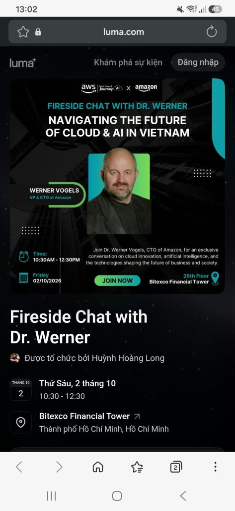
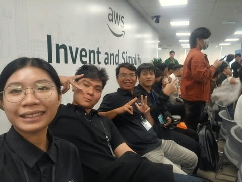

# Bài thu hoạch “Fireside Chat with Dr. Werner: Navigating the Future of Cloud & AI in Vietnam”

### 1. Thông tin chung về sự kiện

* **Tên sự kiện:** Fireside Chat with Dr. Werner: Navigating the Future of Cloud & AI in Vietnam
* **Diễn giả chính:** **Dr. Werner Vogels** — Vice President & Chief Technology Officer (VP & CTO) tại Amazon
* **Đơn vị tổ chức:** AWS First Cloud AI Journey x Amazon (Được tổ chức bởi anh **Huỳnh Hoàng Long**)
* **Thời gian:** 10:30 – 12:30, Thứ Sáu ngày 02/10/2026
* **Địa điểm:** Tầng 26, Tòa nhà Bitexco Financial Tower, Số 02 Hải Triều, Quận 1, TP. Hồ Chí Minh
* **Vai trò:** Người tham dự (Thực tập sinh chương trình First Cloud AI Journey)

---

### 2. Mục đích của sự kiện

* Mang đến buổi trò chuyện trực tiếp và độc quyền giữa **Dr. Werner Vogels (CTO của Amazon)** với cộng đồng kỹ sư trẻ và sinh viên chương trình **First Cloud AI Journey** tại Việt Nam.
* Chia sẻ tầm nhìn chiến lược về làn sóng đổi mới điện toán đám mây (Cloud Innovation), trí tuệ nhân tạo (Artificial Intelligence) và những công nghệ đang định hình tương lai của doanh nghiệp cũng như xã hội.
* Truyền cảm hứng cho thế hệ kỹ sư trẻ tại Việt Nam về tư duy thiết kế hệ thống phân tán bền vững, văn hóa **"Invent and Simplify"** và chuẩn bị hành trang kỹ năng trong kỷ nguyên Cloud & AI.

---

### 3. Nội dung nổi bật từ buổi chia sẻ của Dr. Werner Vogels

#### 1. Triết lý "The Frugal Architect" & Tư duy thiết kế hệ thống thực tế
* **Chi phí và Bảo mật là yêu cầu phi chức năng cốt lõi:** Khi xây dựng hệ thống trên Cloud, kỹ sư không chỉ quan tâm đến việc "chạy được" mà phải coi **Bảo mật (Security)**, **Độ tin cậy (Resilience)** và **Tối ưu chi phí (Cost Awareness)** là các yếu tố hạng nhất ngay từ bản vẽ kiến trúc đầu tiên.
* **"Everything fails, all the time":** Các hệ thống hiện đại phải được thiết kế với giả định rằng bất kỳ thành phần nào cũng có thể gặp sự cố hoặc bị tấn công. Việc phân tách tầng mạng (Multi-AZ VPC), tự động hóa khôi phục và giới hạn phạm vi ảnh hưởng (Blast Radius) là chìa khóa để duy trì dịch vụ liên tục.

#### 2. Sự dịch chuyển của AI: Từ thử nghiệm đến giải quyết bài toán thực tiễn tại Việt Nam
* AI và Generative AI không thay thế kiến thức nền tảng về kỹ thuật phần mềm và hạ tầng đám mây; ngược lại, **dữ liệu sạch (Good Data)** và **hạ tầng Cloud an toàn** mới là nền móng để AI tạo ra giá trị thực tế.
* Khuyến khích sinh viên và kỹ sư tại Việt Nam ứng dụng Cloud & AI để giải quyết những bài toán sát sườn tại địa phương (như nông nghiệp thông minh, giám sát môi trường/thời tiết, giáo dục, tài chính số và an toàn không gian mạng).

#### 3. Bảo mật và Trách nhiệm trong kỷ nguyên AI (Security & Responsible AI)
* Dưới góc độ An toàn thông tin, khi tích hợp AI vào ứng dụng, doanh nghiệp phải kiểm soát chặt chẽ quyền truy cập dữ liệu (Identity & Access Management), mã hóa dữ liệu xuyên suốt và xây dựng các hàng rào bảo vệ (Guardrails) để bảo vệ quyền riêng tư của người dùng.
* Công cụ AI hỗ trợ lập trình (như Amazon Q Developer) giúp tăng tốc độ viết code, nhưng **người kỹ sư vẫn là người chịu trách nhiệm cuối cùng** trong việc hiểu rõ từng dòng cấu hình, từng chính sách IAM Policy trước khi đưa lên môi trường Production.

#### 4. Lời khuyên dành cho sinh viên và kỹ sư trẻ Việt Nam
* **Nắm chắc kiến thức nền tảng (Master the Fundamentals):** Hiểu sâu về mạng máy tính (DNS, TCP/IP, Routing), hệ điều hành, cơ sở dữ liệu và bảo mật định danh — vì công nghệ có thể thay đổi nhanh nhưng các nguyên lý nền tảng của hệ thống phân tán không bao giờ lỗi thời.
* **Học qua thực hành ("Build, Break, and Learn"):** Đừng chỉ đọc lý thuyết hay học vẹt để thi chứng chỉ; hãy trực tiếp bắt tay vào dựng hệ thống trên AWS, thử nghiệm các kịch bản lỗi và chia sẻ lại kiến thức cho cộng đồng.

---

### 4. Bài học rút ra & Ứng dụng vào kỳ thực tập

* **Thấm nhuần tinh thần "Invent and Simplify":** Buổi gặp gỡ trực tiếp CTO của Amazon giúp mình nhận ra rằng một kiến trúc tốt không phải là kiến trúc phức tạp nhất, mà là kiến trúc đơn giản, bảo mật chặt chẽ và tiết kiệm chi phí nhất — đúng như cách nhóm thiết kế giải pháp **Serverless** trong mục **2-Proposal** với chi phí vận hành chỉ ~0,70 USD/tháng.
* **Củng cố định hướng chuyên ngành An toàn thông tin trên Cloud:** Lời nhấn mạnh của Dr. Werner về việc *"Security must be built in from Day 1, not bolted on later"* đã trở thành kim chỉ nam cho quá trình thực hành của mình trong suốt 12 tuần thực tập: từ việc khóa chặt Root User, áp dụng Least Privilege IAM, dùng SSM Session Manager thay cho SSH truyền thống, đến việc thiết lập kết nối riêng tư qua **VPC Endpoints** trong bài **5-Workshop**.
* **Động lực gắn kết cùng tập thể FCAJ:** Được ngồi lắng nghe và trao đổi cùng các anh chị mentor và các bạn đồng trang lứa tại văn phòng AWS Việt Nam (Tầng 26 Bitexco) đã tiếp thêm nguồn năng lượng rất lớn cho mình trong suốt kỳ thực tập.

---

### 5. Hình ảnh kỷ niệm khi tham gia sự kiện tại văn phòng AWS Việt Nam

