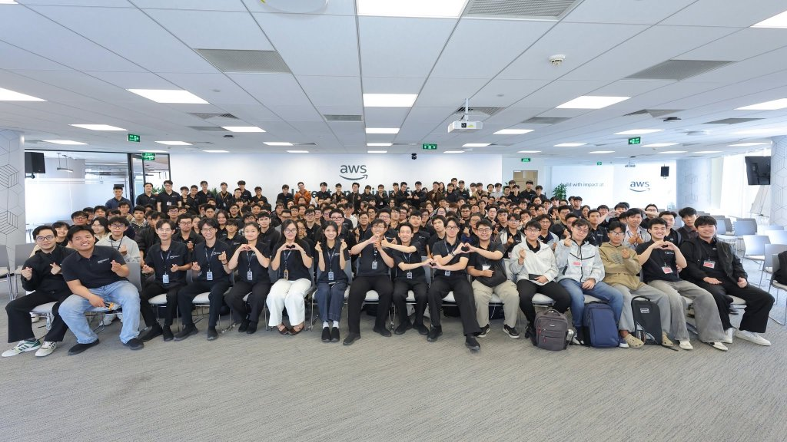
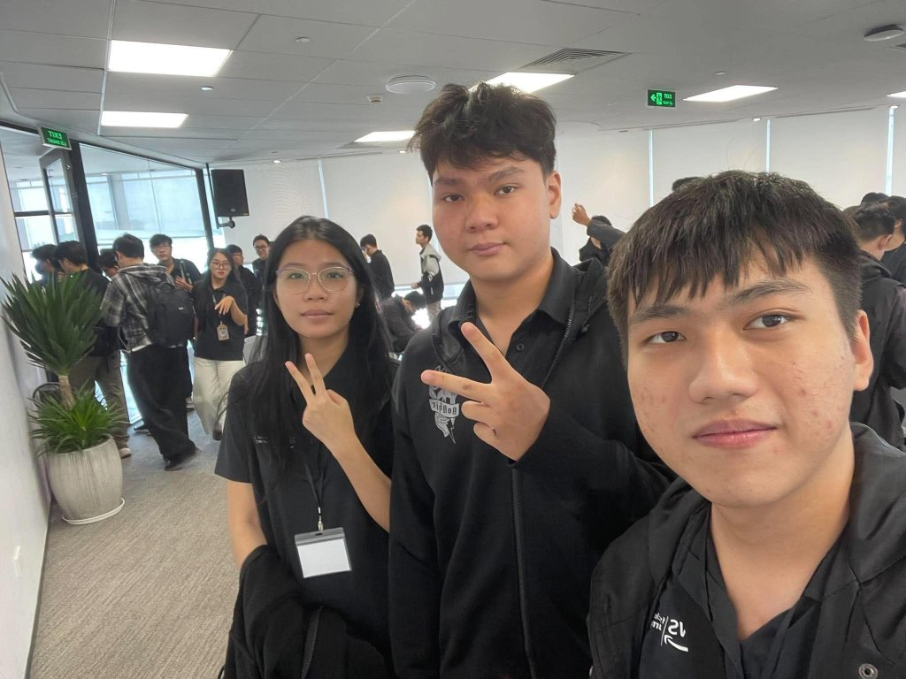

# Event Report: “AWS Cloud Mastery”

### 1. Event Information

* **Event Name:** AWS Cloud Mastery
* **Organizer:** AWS First Cloud AI Journey (FCAJ) & AWS Study Group VN Community
* **Date & Time:** Saturday Morning, 14/11/2026
* **Location:** AWS Vietnam Office – 26th Floor, Bitexco Financial Tower, 02 Hai Trieu Street, District 1, Ho Chi Minh City
* **Role:** Attendee (First Cloud AI Journey Intern)
* **Event Recap Post on AWS Study Group VN:** [View Chau Bao's Recap Post on Facebook Group](https://www.facebook.com/groups/awsstudygroupfcj/permalink/2340764136688545/)

---

### 2. Event Purpose

* Consolidate core cloud engineering competencies to achieve **Cloud Mastery** on AWS-spanning well-architected design, multi-layered security, operational excellence, and cost optimization in real-world projects.
* Foster direct, open dialogue between experienced AWS Mentors / Solutions Architects and university technology students across Ho Chi Minh City.
* Address practical technical challenges encountered during hands-on labs, Proposal/Workshop implementation, and career preparation for Cloud Engineer, Cloud Security, and Solutions Architect roles.

---

### 3. Key Highlights & Activities

#### 1. Mastering Core AWS Architecture & Best Practices
* Explored how to integrate foundational AWS services (Networking, Serverless Compute with Lambda/API Gateway, S3/CloudFront Storage, DynamoDB, and IAM Security) into cohesive production-ready architectures rather than treating services in isolation.
* Reviewed common architectural pitfalls made by junior engineers: overly permissive IAM policies, exposed credentials, misaligned architecture diagrams, and overlooking cost modeling and monitoring.
* Shared practical guidance on structuring technical documentation, drawing standardized AWS architecture diagrams, and defending cloud proposals effectively.

#### 2. Extended Interactive Q&A Session
* A standout highlight of the Saturday morning session was the marathon Q&A discussion filled with practical questions from students across Saigon regarding both technical depth and career growth:
  - **Technical Deep-Dives:** Trade-offs when choosing between Serverless and Container/EC2 architectures; implementing Defense-in-Depth security controls and data protection on AWS.
  - **Career Roadmap:** Transitioning from student intern to Cloud Engineer / Cloud Security Engineer / Solutions Architect, and combining AWS certifications with hands-on project portfolios.

#### 3. Interactive Quiz Game & Community Networking
* The session concluded with an energetic **Interactive Quiz Game** testing participants' understanding of AWS services and architectural scenarios.
* Provided an opportunity to exchange project insights with fellow FCAJ interns while building momentum toward **AWS Student Community Day Vietnam 2026**.

---

### 4. Key Takeaways & Application to My Internship

* **Refining SecureTable & Final Report Quality:** Attending **AWS Cloud Mastery** on `14/11/2026` helped our team verify alignment between our architecture diagram and deployed **SecureTable** services, while double-checking Well-Architected and cost controls ahead of final review.
* **Sharpening My Cloud Security Career Focus:** The Q&A session clarified what employers expect from an **Information Assurance** graduate entering the cloud domain-translating security principles directly into Least-Privilege IAM Policies, Cognito Authorizers, CloudFront OAC, AWS WAF, and CloudWatch/CloudTrail observability.

---

### 5. Photo with My Team at the Event

