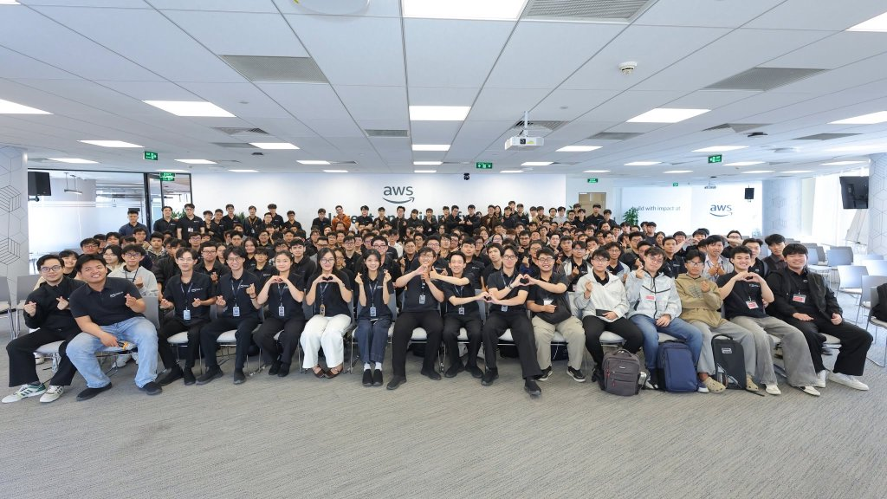
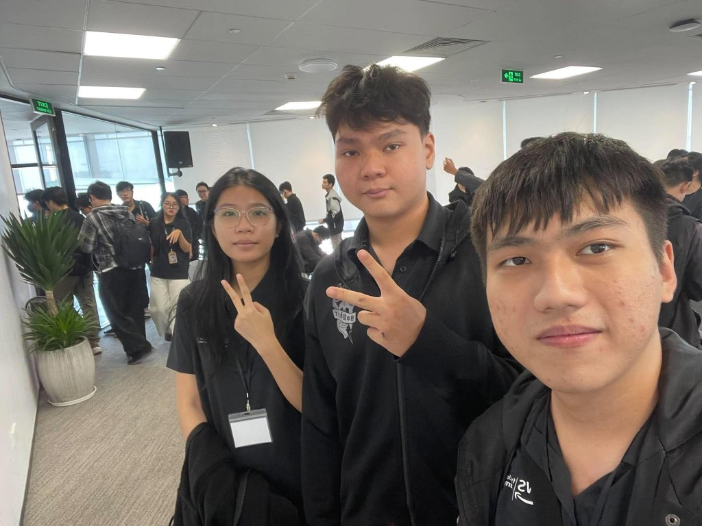

# Bài thu hoạch sự kiện “AWS Cloud Mastery”

### 1. Thông tin chung về sự kiện

* **Tên sự kiện:** AWS Cloud Mastery
* **Đơn vị tổ chức:** Chương trình AWS First Cloud AI Journey (FCAJ) & Cộng đồng AWS Study Group VN
* **Thời gian:** Sáng Thứ Bảy, ngày 14/11/2026
* **Địa điểm:** Văn phòng AWS Việt Nam – Tầng 26, Tòa nhà Bitexco Financial Tower, Số 02 Hải Triều, Quận 1, TP. Hồ Chí Minh
* **Vai trò:** Người tham dự (Thực tập sinh chương trình First Cloud AI Journey)
* **Link bài tổng kết sự kiện trên AWS Study Group VN:** [Xem bài đăng của anh Châu Bảo trên Facebook Group](https://www.facebook.com/groups/awsstudygroupfcj/permalink/2340764136688545/)

---

### 2. Mục đích của sự kiện

* Hệ thống hóa kiến thức trọng tâm để làm chủ nền tảng điện toán đám mây AWS (**Cloud Mastery**), từ tư duy thiết kế kiến trúc chuẩn mực, bảo mật hệ thống cho đến vận hành và tối ưu hóa chi phí trong dự án thực tế.
* Tạo không gian đối thoại trực tiếp, cởi mở giữa các anh chị Mentor / Solutions Architect dày dạn kinh nghiệm với đông đảo sinh viên công nghệ tại TP.HCM.
* Giải đáp chuyên sâu các bài toán kỹ thuật thực tế mà sinh viên gặp phải trong quá trình làm bài Lab, xây dựng Proposal / Workshop cũng như định hướng lộ trình nghề nghiệp Cloud Engineer, Cloud Security và Solutions Architect.

---

### 3. Nội dung & Các hoạt động nổi bật trong sự kiện

#### 1. Làm chủ kiến trúc và thực hành cốt lõi trên AWS (Cloud Mastery Sharing)
* Đi sâu vào cách kết hợp nhịp nhàng các dịch vụ nền tảng của AWS (Networking, Serverless Compute với Lambda/API Gateway, Storage với S3/CloudFront, Database với DynamoDB và IAM Security) thành một kiến trúc hoàn chỉnh thay vì chỉ học rời rạc từng dịch vụ đơn lẻ.
* Phân tích các lỗi cấu hình phổ biến mà sinh viên thường gặp khi triển khai dự án trên AWS: phân quyền IAM quá rộng, lộ thông tin xác thực, vẽ sơ đồ kiến trúc sai luồng dữ liệu thực tế hoặc quên lập dự toán và kiểm soát chi phí.
* Chia sẻ kinh nghiệm xây dựng tài liệu kỹ thuật, thiết kế sơ đồ kiến trúc chuẩn AWS và bảo vệ giải pháp (Proposal & Workshop) thuyết phục dưới góc nhìn doanh nghiệp.

#### 2. Phiên thảo luận & Hỏi đáp chuyên sâu (Open Q&A)
* Điểm nhấn đặc biệt nhất của buổi sáng Thứ Bảy là phần giao lưu hỏi đáp diễn ra vô cùng sôi nổi (*"không có hồi kết"*) với hàng loạt câu hỏi thực tế từ các bạn sinh viên đến từ khắp các trường đại học tại TP.HCM:
  - **Về chuyên môn kỹ thuật:** Cách lựa chọn giữa kiến trúc Serverless và Container/EC2 cho dự án quy mô nhỏ và vừa; cách thiết lập bảo mật đa tầng (Defense in Depth) và kiểm soát truy cập dữ liệu an toàn trên Cloud.
  - **Về định hướng nghề nghiệp:** Lộ trình phát triển từ sinh viên thực tập lên vị trí Cloud Engineer / Cloud Security Engineer / Solutions Architect; kinh nghiệm ôn luyện chứng chỉ AWS quốc tế kết hợp với làm dự án thực chiến.

#### 3. Hoạt động Interactive Quiz Game & Kết nối cộng đồng
* Cuối chương trình là phần **Game Quiz** tương tác trực tiếp, giúp các bạn sinh viên ôn tập nhanh và kiểm tra lại độ hiểu sâu về các dịch vụ AWS trong bầu không khí hào hứng, sôi động.
* Sự kiện cũng là dịp để mình gặp gỡ, trao đổi kinh nghiệm hoàn thiện dự án với các bạn thực tập sinh FCAJ và hướng tới ngày hội **AWS Student Community Day Vietnam 2026**.

---

### 4. Bài học rút ra & Ứng dụng vào kỳ thực tập

* **Hoàn thiện chất lượng dự án SecureTable & Báo cáo thực tập:** Những chia sẻ tại buổi **Cloud Mastery** (`14/11/2026`) giúp nhóm mình rà soát lại độ khớp giữa sơ đồ kiến trúc và hệ thống triển khai thực tế của **SecureTable**, cũng như kiểm tra kỹ các tiêu chí Well-Architected và tối ưu chi phí trước khi nghiệm thu.
* **Rõ ràng hơn về định hướng Cloud Security:** Phần hỏi đáp thực tế giúp mình hiểu rõ doanh nghiệp kỳ vọng gì ở một sinh viên ngành **An toàn thông tin** khi bước vào mảng Cloud: chuyển hóa nguyên lý bảo mật thành IAM Policy tối thiểu, Cognito Authorizer, CloudFront OAC, WAF và giám sát CloudWatch/CloudTrail.

---

### 5. Hình ảnh check-in khi tham gia sự kiện tại văn phòng AWS Việt Nam

